


  

 

> *Turning raw data into decision-ready insight, and ideas into production-ready AI.*

I'm a **Data & AI professional with 2+ years of hands-on experience** in Python, SQL, machine learning and LLM integrations, delivering for **UAE and UK clients**. I hold an **MCA in Artificial Intelligence & Machine Learning** from Lovely Professional University and a **granted patent** for a physics-constrained ocean intelligence platform with a domain-constrained LLM interface.

I build across the full data lifecycle: **pipelines → models → dashboards → AI agents**, and I communicate technical progress clearly to business stakeholders. I'm a quick learner and **willing to learn any new tool or domain**.

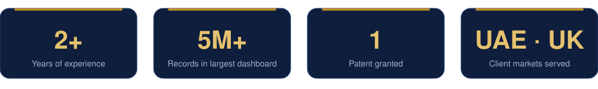

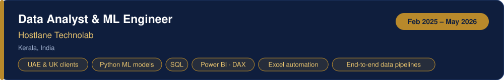

- Built and deployed Python ML models and AI solutions for **UAE and UK clients**, turning raw data into production-ready tools
- Owned the **end-to-end data pipeline**: collection, cleaning and preprocessing of structured and unstructured datasets
- Wrote **SQL** (joins, aggregations, subqueries) for extraction, validation and modeling
- Automated Excel reporting and designed interactive **Power BI dashboards** (DAX, Power Query) for at-a-glance KPI visibility
- Translated business requirements into practical AI solutions and communicated progress to client stakeholders

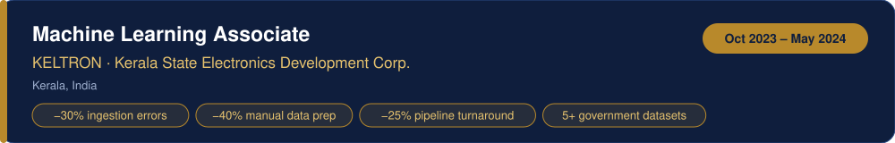

- Engineered ETL and feature-engineering pipelines across **5+ government datasets**, cutting ingestion errors by **30%**
- Automated batch ML workflows across 4 projects: **40% less manual prep**, **25% faster turnaround**
- Applied EDA, hypothesis testing and distributional analysis to improve model performance

<table>
<tr>
<td width="50%">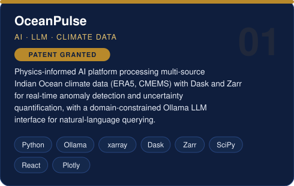</td>
<td width="50%">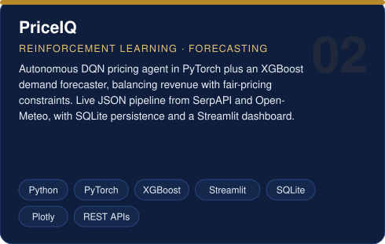</td>
</tr>
<tr>
<td width="50%">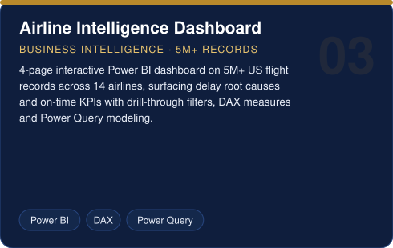</td>
<td width="50%">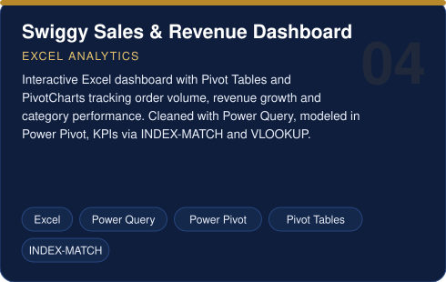</td>
</tr>
</table>

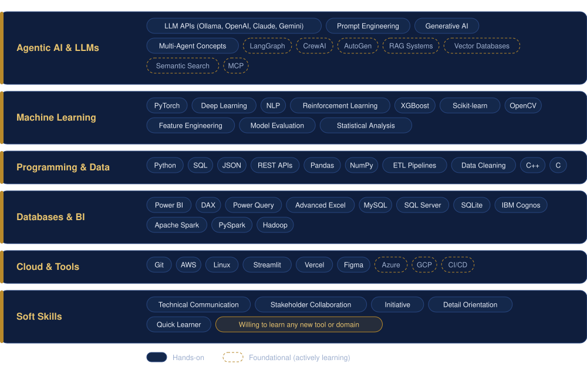

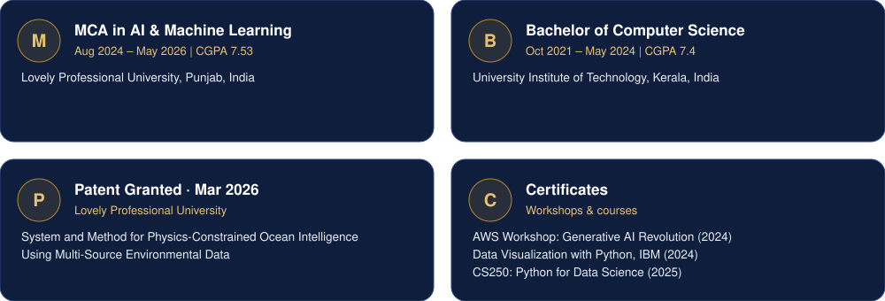

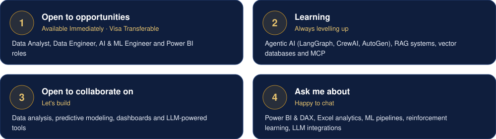

  

